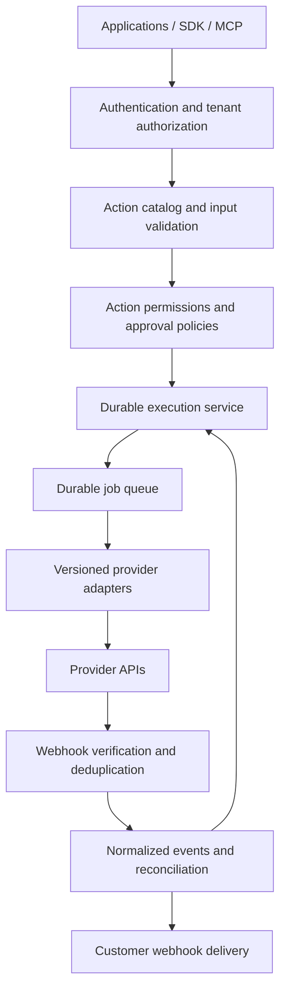

# AfriPay integration platform blueprint

Status: proposal for discussion. This document describes intended capabilities,
not features currently implemented by this repository.

## Product direction

Build a unified integration layer for African payment, identity, banking, and
telecom services. Developers connect provider accounts once, discover supported
capabilities, execute typed actions, and receive consistent status events.

The Composio analogy suggests a connection and action platform with REST APIs,
SDKs, and MCP tools for AI agents. These interfaces should use the same
authorization and execution layer. Whether AI-agent builders are the primary
customer remains an open product decision.

Start with customer-owned provider accounts. A managed aggregator model, in
which AfriPay contracts and transacts directly, would require a separate
commercial and regulatory assessment. Bringing credentials does not by itself
resolve provider-contract or licensing requirements.

## Initial customer and MVP

Recommended initial customer: engineering teams building merchant onboarding
and payment collection for African businesses.

Choose one or two markets based on design-partner demand and provider access.
Support three to five connectors across KYC and payments. Deliver one complete
workflow: verify a merchant, collect a payment, and receive its final status.
These scope choices are hypotheses to validate, not confirmed market findings.

The MVP includes:

- A catalog of providers, capabilities, countries, currencies, sandbox support,
  and onboarding requirements.
- Tenant-scoped provider connections with encrypted credentials and separate
  sandbox and production environments.
- Typed actions, documented provider-specific options, and normalized errors.
- Durable execution, idempotency, status lookup, and reconciliation.
- Signed customer webhooks with delivery history and retries.
- A REST API, TypeScript SDK, sandbox examples, and a connection dashboard.
- Audit records and usage metering with explicit billing rules.

Expand into banking and telecom based on production demand. Add MCP access once
the underlying action permissions and approval policies can be enforced.

## Capability model

Normalize shared capabilities while preserving meaningful provider differences.
Each connector explicitly declares the actions it supports. Unsupported actions
must fail validation before contacting a provider.

| Domain | Candidate actions | Differences to preserve |
| --- | --- | --- |
| Payments | Create collection, get status, refund | Payment methods, currencies, settlement, refund support |
| KYC | Verify identity, verify business, get status | Country coverage, documents, consent, retention |
| Banking | Resolve account, read balance, initiate transfer | Bank coverage, access permissions, licensing |
| Telecom | Buy airtime, buy data, send SMS | Operators, bundles, sender registration, delivery status |

Version connector implementations and action schemas. Existing integrations must
not silently adopt breaking provider or schema changes.

## Proposed execution contract

The following is an illustrative contract, not an existing endpoint. Each action
will define its full required input schema, including payment-method-specific
fields where applicable.

```http
POST /v1/executions
Authorization: Bearer <project-token>
Idempotency-Key: merchant-order-123
Content-Type: application/json
```

```json
{
  "connection_id": "conn_123",
  "action": "payments.collection.create",
  "input": {
    "amount_minor": 5000,
    "currency": "NGN",
    "reference": "order_123"
  }
}
```

Return an execution ID and explicit status. Store monetary values as integer
minor units with currency-specific validation. Payment acceptance is distinct
from settlement; provider events and reconciliation establish subsequent states.

Scope idempotency keys to the tenant, environment, connection, and action. Reusing
a key with a different payload must return a conflict. Define and publish the
key-retention window. Concurrent duplicate requests must resolve to the same
execution rather than create independent provider calls.

## Architecture



Start with a modular service, PostgreSQL, and a durable queue. Separate provider
adapters from authorization, execution policy, storage, and billing. Isolate
credential access and redact secrets and sensitive identity data from logs.

Core records: tenants, projects, connections, connector versions, action
definitions, executions, execution attempts, provider event receipts, customer
delivery attempts, audit events, and usage records.

Each adapter owns authentication details, request and response mapping,
capability declarations, provider error classification, status lookup, and
webhook parsing. The shared execution layer owns authorization, attempt history,
retry policy, and idempotency.

## Reliability and trust

- Scope every connection, execution, and status query to its tenant and
  environment. Enforce action permissions before resolving provider credentials.
- Encrypt secrets, support rotation, and record credential access without
  recording credential values.
- Use provider idempotency where supported. If an outcome is ambiguous after a
  timeout, reconcile status before retrying a money movement. Automatic fallback
  to another provider can duplicate charges.
- Retry only failures classified as safe for that action and provider. Respect
  rate limits, use bounded backoff, and expose exhausted or unresolved attempts
  for investigation.
- Verify provider webhook signatures where supported. Define a secure
  provider-specific alternative or exclude unverified callbacks from driving
  financial state transitions. Deduplicate receipts and tolerate out-of-order
  events without regressing confirmed outcomes.
- Distinguish pending, successful, failed, and unknown outcomes. Preserve
  provider references and keep settlement state separate where applicable.
- Sign outgoing webhooks, bound delivery retries, and support controlled replay.
  Prevent tenant-configured delivery URLs from reaching private infrastructure.
- Require server-enforced approval policies for agent financial actions,
  including recipient, amount, and frequency limits. Approval must be bound to
  the exact action inputs and expire if those inputs change.
- Establish country- and provider-specific consent, retention, data-location,
  and permitted-use requirements before launch. Minimize stored KYC data.
- Confirm provider agreements allow the intended intermediary access model.

## Delivery milestones

| Milestone | Scope | Exit criteria |
| --- | --- | --- |
| Validate demand | Customer segment, markets, provider access | Design partners confirm the workflow; sandbox access and contractual requirements are documented |
| Build foundations | Tenant isolation, credential storage, adapter contract, durable execution | One sandbox connector completes a traced execution; cross-tenant access is rejected |
| Deliver MVP workflow | Payment and KYC connectors, events, reconciliation, SDK, dashboard | A design partner completes verification and collection end to end with visible final status |
| Prove reliability | Failure handling and operational recovery | Duplicate requests, ambiguous timeouts, invalid signatures, repeated and out-of-order events, expired credentials, and webhook redelivery are exercised |
| Expand from usage | Requested connectors and domains; governed MCP access | Production demand justifies each addition; new adapters pass the common contract checks |

Use provider sandbox tests and deterministic adapter contract fixtures. Avoid
real financial operations in automated checks. Test tenant boundaries,
concurrent idempotent requests, financial state transitions, reconciliation,
and approval binding before exposing live execution.

## Commercial model and measurements

Start with a platform subscription plus execution usage, keeping provider charges
explicitly separate. Define billable events so internal retries and duplicate
webhook deliveries do not unexpectedly increase charges. Enterprise options
can include private connectors and support commitments.

Track time to first successful integration, active production connections,
workflow completion rate, unresolved execution age, webhook delivery success,
and maintenance cost per connector. Set service targets after observing actual
provider behavior rather than promising unsupported availability.

## Existing repository assessment

The repository currently contains an early Jinipay Node.js SDK:

- [The entry point](../index.js) exposes Customer, Order, and Transaction clients.
- [Customer operations](../core/customer/index.js) partially implement creation.
- [Order](../core/order/index.js) and
  [transaction](../core/transaction/index.js) operations contain stubs.
- [The request layer](../core/main.js) targets fixed Jinipay endpoints and logs
  request headers containing credentials. Remove credential logging before any
  live use.
- [The package manifest](../package.json) contains a placeholder failing test
  command; the proposed platform has no implemented validation suite yet.

Treat this SDK as a legacy integration reference. Decide whether to preserve it
as a compatibility package before changing its public interface. The platform
described here requires a broader backend; this proposal does not implement it.

## Decisions needed before implementation

1. Who is the first buyer: application developers, AI-agent builders, or internal
   operations teams?
2. Which markets and providers have actual customer demand and accessible
   accounts?
3. Will customers bring provider accounts, or will AfriPay act as an aggregator?
4. Should the existing SDK remain a separately maintained compatibility package?

Recommended starting assumption: developer-first, customer-owned accounts,
merchant KYC plus payment collection, with AI access using the same governed
actions. Confirm these assumptions with design partners before implementation.
